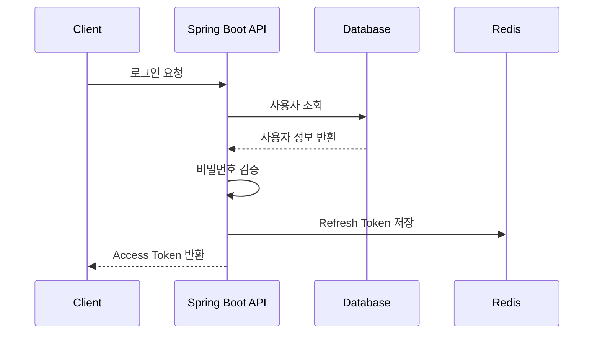

# 개발 팀 프로젝트에서 Obsidian 활용하기

> 요약: 개발팀의 기술 문서·아키텍처·API·ADR·회의록·트러블슈팅을 Git 저장소 안 Obsidian 볼트로 관리하는 실전 가이드. 공유 방식 4종 비교, 폴더 구조, 플러그인, PR 워크플로, 문서 사이트 배포, AI 에이전트 인수인계(9장), 템플릿, 보안 포함. | 언제: 팀 프로젝트 문서 체계를 잡을 때, Obsidian을 팀에 도입할지 판단할 때, 큰 프로젝트를 여러 AI·세션에 걸쳐 이어갈 때 | 키워드: Obsidian, 옵시디언, 볼트, docs-as-code, ADR, Obsidian Git, Bases, Relay, MkDocs, 인수인계 | 관련 스킬: obsidian-project-flow | 출처: Obsidian 공식 도움말 + 실사용 사례(16장) | 갱신: 2026-11-25

- 권장 조합: **Obsidian + GitHub Private Repository + GitHub Issues/Projects + Slack/Discord**
- 조사·정리 기준일: 2026-11-25. 가격·인원 제한·뷰 종류는 바뀔 수 있으니 도입 시점에 16장 공식 링크로 다시 확인한다.
- 여러 AI·세션에 걸친 작업 흐름 이어가기만 필요하면 9장과 스킬 `obsidian-project-flow`부터 본다.

---

## 목차

1. [핵심 요약](#1-핵심-요약)
2. [Obsidian을 팀 프로젝트에 도입하는 이유](#2-obsidian을-팀-프로젝트에-도입하는-이유)
3. [팀 문서 공유 방식 비교](#3-팀-문서-공유-방식-비교)
4. [개발팀에서 활용할 수 있는 8가지 분야](#4-개발팀에서-활용할-수-있는-8가지-분야)
5. [권장 Vault 폴더 구조](#5-권장-vault-폴더-구조)
6. [핵심 기능과 커뮤니티 플러그인](#6-핵심-기능과-커뮤니티-플러그인)
7. [GitHub 연동 및 협업 Workflow](#7-github-연동-및-협업-workflow)
8. [문서 사이트로 배포하기](#8-문서-사이트로-배포하기)
9. [AI 에이전트와 작업 흐름 이어가기](#9-ai-에이전트와-작업-흐름-이어가기)
10. [실제 적용 예시: 여행 계획 서비스(가상)](#10-실제-적용-예시-여행-계획-서비스가상)
11. [바로 복사해서 쓸 수 있는 문서 템플릿](#11-바로-복사해서-쓸-수-있는-문서-템플릿)
12. [운영 규칙과 보안](#12-운영-규칙과-보안)
13. [단계별 도입 계획](#13-단계별-도입-계획)
14. [도입 전 체크리스트](#14-도입-전-체크리스트)
15. [Obsidian이 적합하지 않은 상황](#15-obsidian이-적합하지-않은-상황)
16. [공식 문서 및 참고 링크](#16-공식-문서-및-참고-링크)

---

## 1. 핵심 요약

Obsidian을 개발팀에 도입할 때 가장 적합한 역할은 **팀의 기술 문서와 프로젝트 지식을 연결해 축적하는 공동 지식 베이스(Team Knowledge Base)**다.

Obsidian은 Markdown 파일을 로컬 폴더(Vault)에 저장한다. 따라서 문서를 일반 텍스트 파일로 보관하고 Git으로 버전 관리할 수 있다. 문서 간 내부 링크와 역방향 링크(Backlinks)를 통해 요구사항, API, 데이터 모델, 기술 설계, 장애 해결 기록을 서로 연결할 수 있다는 점이 핵심 장점이다.

### 1.1 추천 도구 역할 분담

| 도구 | 맡길 역할 | 관리할 정보의 예 |
|---|---|---|
| Obsidian | 기술 지식 및 프로젝트 문서 | 아키텍처, API 설명, ADR, 회의 결정, 트러블슈팅 |
| GitHub Repository | 코드와 문서의 버전 관리 | 소스 코드, Markdown, 변경 이력 |
| GitHub Issues / Projects | 작업 추적 | 담당자, 우선순위, 진행 상태, 마감일 |
| Slack / Discord | 실시간 소통 | 질문, 알림, 긴급 공유 |
| Swagger / OpenAPI | 실행 가능한 API 명세 | 엔드포인트, 요청·응답 스키마 |
| Notion / Google Docs | 실시간 공동 문서 작성이 필요한 경우 | 동시 편집이 잦은 문서, 비개발 조직과의 협업 |

**중요한 원칙:** GitHub Issues에 작업 상태를 관리하고, Obsidian에는 그 작업을 이해하고 구현하기 위한 배경·설계·정책을 관리한다. 동일한 상태 정보를 여러 도구에 중복으로 입력하지 않는다.

### 1.2 가장 추천하는 운영 방식

- 문서 저장소: GitHub Private Repository
- 문서 형식: Markdown (`.md`)
- 편집 도구: Obsidian Desktop
- Git 사용: Obsidian Git 플러그인 또는 Git CLI / GitHub Desktop
- 협업 방식: 기능 브랜치 → Commit → Push → Pull Request → Review → Merge
- 핵심 문서: 프로젝트 개요, 요구사항, 아키텍처, API/DB 설계, ADR, 회의록, 트러블슈팅, 배포 Runbook

처음부터 모든 기능을 도입하지 말고 **아키텍처 + API/DB 설계 + ADR + 회의록 + 트러블슈팅**부터 시작하는 것이 좋다.

---

## 2. Obsidian을 팀 프로젝트에 도입하는 이유

### 2.1 Markdown 파일 기반

Obsidian의 Vault는 기본적으로 로컬 파일과 폴더다. 문서는 Markdown으로 저장되므로 특정 SaaS 서비스의 전용 데이터베이스에만 갇히지 않는다.

이 구조가 개발팀에 유리한 이유는 다음과 같다.

- Git으로 문서 변경 이력을 확인할 수 있다.
- 코드 저장소와 같은 방식으로 Commit, Branch, Review를 적용할 수 있다.
- 편집기나 도구를 바꾸더라도 Markdown 파일을 다른 도구에서 활용하기 쉽다.
- 오프라인에서도 로컬 문서를 열고 수정할 수 있다.
- 코드, 이미지, 다이어그램, 문서를 프로젝트 단위로 묶을 수 있다.

### 2.2 문서 간 연결

Obsidian에서는 `[[문서 이름]]` 형태의 내부 링크를 사용할 수 있다.

예시:

```markdown
# 여행 일정 편집

## 관련 기능
- [[여행 계획 생성]]
- [[장소 검색]]
- [[여행 장소 추가]]
- [[여행 장소 순서 변경]]

## 관련 설계
- [[여행 일정 API]]
- [[Trip Entity]]
- [[ADR-0002 일정 수정 정책]]
```

하나의 기능 문서에서 연결된 API, 엔티티, 설계 결정 문서로 이동할 수 있다. Backlinks를 확인하면 현재 문서를 참조하고 있는 다른 문서도 찾을 수 있다.

**주의:** GitHub 웹 화면에서 Obsidian의 `[[Wikilink]]`가 Obsidian과 똑같이 해석되는 것은 아니다. GitHub에서 문서 링크까지 자연스럽게 탐색해야 한다면 `[여행 일정 API](../API/여행%20일정%20API.md)`처럼 상대 경로 Markdown 링크를 사용하거나, 팀에서 Obsidian 내부 링크와 외부 표시 방법을 정해야 한다.

### 2.3 문서 구조를 지식 그래프로 확장

프로젝트가 커질수록 단순 폴더만으로 문서 간 관계를 파악하기 어려워진다. Obsidian의 Graph View와 Backlinks는 서로 다른 폴더에 있는 문서의 연결 관계를 보여준다.

예를 들어 `Redis 캐싱 도입` ADR을 수정하면 해당 ADR을 참조하는 캐시 정책, 성능 테스트, 운영 문서를 역방향 링크로 찾을 수 있다.

### 2.4 라이선스와 비용

2025-02-20부터 상용 라이선스가 선택 사항이 되어 회사 업무에도 Obsidian 앱을 무료로 쓸 수 있다. 돈이 드는 것은 Sync·Publish 같은 부가 서비스뿐이다.

### 2.5 실제 도입 사례 (요약)

| 사례 | 무엇을 했나 | 시사점 |
| --- | --- | --- |
| Atomic Object 개발팀 | 엔티티 순환 의존 문제를 Canvas·그래프 뷰로 시각화하고, 볼트를 소스 저장소 하위 폴더로 두어 결정 기록을 검색 가능하게 함 | 복잡한 도메인 관계 설명과 지식 전달에 강함. 별도 권한 설정 없이 기존 저장소 권한을 그대로 씀 |
| 12개 엔지니어링팀(dev.to 기고) | Confluence + 자체 도구를 Obsidian(+Dataview) + Hugo로 바꾸고 14개월 추적 | 기고자 주장으로 문서 반영 시간 40% 감소. 자체 측정 수치라 그대로 일반화하지 않는다 |
| 러시아 개발팀(Habr) | Trello 대신 Obsidian 볼트를 스크럼 보드로 사용. Dataview·Templater·Obsidian Git 기본 설치, pull은 자동·push는 명령으로만 | 자동 push를 끄고 의도적으로 push하는 설정이 팀 운영에 안전 |

---

## 3. 팀 문서 공유 방식 비교

팀이 Obsidian을 함께 쓰려면 각자의 Vault 변경사항을 어떻게 공유할지 결정해야 한다. 주요 선택지는 Git 기반 공유(A)와 Obsidian Sync 공유 Vault(B)이고, 보조 선택지로 클라우드 공유 폴더(C)와 실시간 협업 플러그인(D)이 있다.

### 3.1 방식 A: GitHub 기반 공동 Vault

```text
팀원 A의 Obsidian Vault
        |
        | Commit / Push
        v
GitHub Private Repository
        ^
        | Pull / Merge
        |
팀원 B의 Obsidian Vault
```

**동작 방식**

1. 팀원이 공통 Git 저장소를 Clone한다.
2. 각자 로컬 Obsidian에서 문서를 수정한다.
3. Git Commit으로 변경사항을 기록한다.
4. Push 또는 Pull Request로 GitHub에 공유한다.
5. 리뷰와 Merge를 거친 뒤 다른 팀원이 Pull한다.

**장점**

- GitHub의 PR, Review, Branch Protection 등 기존 개발 워크플로를 활용할 수 있다.
- 문서 변경 이력을 Commit 단위로 확인할 수 있다.
- 비용 부담을 줄이기 쉽다. Obsidian 앱 자체는 무료로 사용할 수 있고, GitHub 저장소 요금은 조직 정책과 사용량에 따라 확인하면 된다.
- 코드 저장소와 문서 저장소를 분리하거나 같은 저장소에 둘 수 있다.

**단점 및 주의점**

- 실시간 동기화가 아니다. Push와 Pull이 필요하다.
- 같은 Markdown 파일을 여러 명이 동시에 수정하면 Merge Conflict가 발생할 수 있다.
- Git을 잘 모르는 팀원에게 초기 사용법을 안내해야 한다.
- Obsidian Git 플러그인의 자동 Push만 사용하면 PR 리뷰 절차를 건너뛸 수 있으므로 운영 원칙이 필요하다.

**추천 대상:** 개발자 중심 팀, GitHub를 이미 사용하는 팀, 문서 변경도 코드처럼 리뷰하고 싶은 팀.

### 3.2 방식 B: Obsidian Sync 공유 Vault

Obsidian의 공식 Sync 서비스를 이용하면 공유 Vault를 팀원들과 동기화할 수 있다.

**확인된 공식 제약 사항**

- 공유 Vault는 최대 20명까지 공유할 수 있다.
- 공유 Vault에 참여하는 협업자는 각자 활성화된 Obsidian Sync 구독이 필요하다.
- 동일 문서의 실시간 공동 편집은 지원하지 않는다. 다른 사용자의 커서가 보이지 않으며, 수정 내용은 동기화된 뒤 반영된다.
- 같은 파일을 동시에 수정하면 동기화 과정에서 변경사항 병합 및 충돌 처리가 발생할 수 있다.
- 세밀한 사용자별 권한 설정은 지원하지 않는다. Vault 소유자를 제외한 협업자는 동일한 권한을 갖고, 초대는 소유자만 할 수 있다.
- Sync는 Obsidian이 실행 중일 때 파일을 동기화한다.
- 첨부 파일 크기 한도는 공유 Vault를 만든 사람의 요금제를 따른다(Standard 5MB, Plus 200MB).
- 상용 라이선스와 별개로 구매해야 하고, 사내 설치형(온프레미스) 서버는 없다.

**장점**

- Git 명령어를 잘 모르는 팀원도 상대적으로 쉽게 공유 Vault를 사용할 수 있다.
- 공식 종단 간 암호화 동기화 서비스를 사용할 수 있다.
- 같은 문서 공간을 여러 장치에서 사용할 수 있다.

**단점**

- 팀원마다 구독이 필요해 인원수에 비례해 비용이 발생한다.
- 코드 리뷰처럼 문서 변경을 PR 승인 후 반영하는 흐름과는 성격이 다르다.
- 세밀한 문서별 권한 관리가 어렵다.
- 같은 문서의 동시 편집은 여전히 주의해야 한다.

**추천 대상:** 소규모 팀, Git 사용이 익숙하지 않은 팀, PR 기반 문서 리뷰가 필수는 아닌 팀.

### 3.3 방식 C: 클라우드 공유 폴더 (Dropbox·Google Drive·OneDrive·iCloud)

Vault도 작은 텍스트 파일이 든 폴더일 뿐이라, 팀 공유 드라이브에 두기만 해도 함께 쓸 수 있다. 국내 사례 중에는 프로젝트 리더가 Dropbox 공유 폴더 안에 협업용 Vault를 만들고, 팀원이 그 폴더를 Vault로 여는 방식(Vault-in-Vault)도 있다.

- 장점: 설정이 가장 쉽고 추가 비용이 거의 없다.
- 단점: 동시에 고치면 충돌 사본 파일이 생기거나 한쪽 수정이 덮어써질 수 있다. 권한은 폴더 단위로만 나뉜다. 변경 리뷰 절차가 없다.
- 용도: 비개발자가 섞인 소규모 팀의 회의록·자료 공유. 코드와 함께 리뷰할 기술 문서에는 A를 쓴다.
- **주의:** Git 저장소(`.git`)를 클라우드 동기화 폴더 안에 두지 않는다. 동기화 프로그램이 `.git` 내부 파일을 건드려 저장소가 깨질 수 있다.

### 3.4 방식 D: 실시간 협업 플러그인 (Relay 등)

Obsidian 자체에는 실시간 공동 편집이 없어서 커뮤니티 플러그인이 이를 채운다.

| 플러그인 | 방식 | 참고 |
| --- | --- | --- |
| Relay (System 3) | CRDT 기반 실시간·오프라인 편집, 폴더 공유, 커서 표시 | 가장 많이 쓰임(약 22.8만 다운로드). 운영사가 실시간 협업은 아직 종단간 암호화를 지원하지 못한다고 밝힘 |
| Peerdraft | 실시간 편집, 웹 편집기, REST API·MCP 연동 | 공식 디렉터리 검토 등급이 "주의(Caution)"로 표시됨 |
| Team Relay·Synkk·SupSync 등 | 자체 서버(셀프호스팅) 기반 실시간 동기화 | 다운로드 수가 적은 신생 플러그인. 서버 운영 부담 있음 |

- 쓸 때: 같은 문서를 여러 명이 회의 중에 함께 고치는 일이 잦을 때.
- 주의: 비공식 플러그인에 볼트 전체를 맡기는 것이므로 12.5절의 플러그인 보안 기준으로 검토한다. Git 방식과 같은 폴더에 섞어 쓰면 동기화가 두 겹이 되므로 공유 폴더 범위를 분리한다.

### 3.5 방식 비교 (A vs B)

| 비교 기준 | GitHub 기반 | Obsidian Sync |
|---|---|---|
| 문서 저장 | Markdown 파일 + Git | Markdown 파일 + 공식 Sync |
| 동기화 | Commit / Push / Pull | Obsidian 실행 중 자동 동기화 |
| 실시간 공동 편집 | 지원하지 않음 | 지원하지 않음 |
| 변경 이력 | Git Commit / PR | Sync 버전 기록 |
| 리뷰 절차 | PR Review 적용 가능 | 일반적인 PR 승인 흐름과 다름 |
| 권한 관리 | GitHub 저장소/브랜치 권한 | 공유 Vault의 세밀한 권한 제한 미지원 |
| 비용 | GitHub 요금제 및 정책에 따름 | 모든 공유 참여자에게 Sync 구독 필요 |
| 최대 인원 | GitHub 플랜 및 조직 정책에 따름 | 공유 Vault 최대 20명 |
| 추천 용도 | 개발 중심 협업 | 편리한 문서 동기화 |

### 3.6 무엇을 선택할까?

개발팀이라면 우선 **GitHub 기반 공동 Vault**를 추천한다. 문서를 코드와 같은 저장소에서 관리하고 PR에 문서 변경을 포함시키면, 구현 변경과 설계 문서 변경을 함께 리뷰할 수 있기 때문이다.

단, 팀원이 Git에 익숙하지 않고 문서 PR 리뷰가 필요하지 않다면 Obsidian Sync가 더 간편할 수 있다. 실시간 공동 편집이 꼭 필요한 문서만 D(Relay 등)를 별도 폴더에 붙이고, 비개발 조직과의 일반 위키는 Notion 등과 병행(하이브리드)하는 것도 흔한 선택이다. 한 Vault에 Git 기반 동기화와 Obsidian Sync 또는 OneDrive/Dropbox 등의 동기화 서비스를 무분별하게 중복 적용하지 않는다. 중복 동기화는 파일 충돌이나 중복 파일을 유발할 수 있으므로 각 Vault의 동기화 방식을 하나로 정한다.

---

## 4. 개발팀에서 활용할 수 있는 8가지 분야

### 4.1 프로젝트 기획 및 요구사항 관리

프로젝트가 무엇을 해결하는지, 대상 사용자가 누구인지, 어떤 기능과 정책을 제공하는지 기록한다.

| 문서 | 기록할 내용 |
|---|---|
| Project Overview | 프로젝트 목적, 대상 사용자, 핵심 가치, 범위 |
| PRD | 기능 요구사항, 정책, 제약사항 |
| User Flow | 사용자 이용 흐름 |
| Use Case | 사용자별 기능 시나리오 |
| Feature Specification | 기능별 입력·처리·출력·예외 상황 |
| Non-functional Requirements | 성능, 보안, 가용성, 확장성 요구사항 |

기능 단위로 문서를 나누고 서로 연결한다. 예를 들어 장소 검색 기능 문서에는 사용자 요구사항, 카카오 로컬 API 연동 문서, 장소 도메인 문서, 관련 API 문서를 연결한다.

### 4.2 아키텍처 및 기술 설계

개발팀에서 가장 가치가 높은 활용 분야 중 하나다. 시스템의 구성뿐 아니라 구성 요소의 책임, 데이터 흐름, 장애 대응, 기술 선택 근거를 기록한다.

추천 문서:

- System Architecture: 전체 시스템 구성도
- Backend Architecture: Controller, Service, Repository 등 백엔드 계층의 책임
- Frontend Architecture: 페이지, 컴포넌트, 상태 관리 구조
- Database Design: ERD, 테이블, 인덱스, 관계
- Authentication: 인증·인가 방식
- Cache Strategy: Redis 캐시 대상, TTL, 무효화 정책
- Deployment Architecture: Nginx, 애플리케이션, DB, Redis, 네트워크 구조

Mermaid를 사용하면 Markdown 코드로 흐름도와 시퀀스 다이어그램을 관리할 수 있다.



Obsidian은 Mermaid 코드 블록을 기본 지원한다. 복잡한 시스템 구조를 손으로 자유롭게 그릴 필요가 있으면 Excalidraw 플러그인을 추가로 고려한다.

### 4.3 ADR(Architecture Decision Record)

ADR은 중요한 기술적 의사결정과 그 근거를 남기는 문서다. 단순히 현재 기술 스택을 나열하는 것과 다르다.

기록할 수 있는 결정의 예:

- JWT와 세션 중 인증 방식 선택
- Redis 도입 여부
- JPA와 MyBatis 중 데이터 접근 기술 선택
- 동기 처리와 비동기 처리 방식
- 데이터베이스 인덱스 추가 근거
- Docker 기반 배포 환경 통일
- 모듈 분리 및 패키지 구조

ADR에는 최소한 다음 내용을 넣는다.

1. Context: 어떤 문제 또는 배경 때문에 결정이 필요한가?
2. Alternatives: 어떤 대안을 검토했는가?
3. Decision: 어떤 방식을 선택했는가?
4. Consequences: 선택으로 얻는 이점과 감수해야 할 단점은 무엇인가?
5. Status: Proposed, Accepted, Deprecated, Superseded 등 현재 상태는 무엇인가?

ADR은 기술 선택의 이유를 미래의 팀원에게 전달하고, 과거의 결정을 다시 검토할 때 유용하다.

### 4.4 API 및 데이터베이스 문서

API 문서는 단순한 URL 목록이 아니라 비즈니스 규칙을 이해할 수 있도록 구성한다.

기록 항목 예시:

- HTTP Method 및 Path
- API 목적
- 인증/인가 필요 여부
- Request / Response 예시
- 유효성 검증 규칙
- 성공 및 실패 응답
- 트랜잭션 범위
- 관련 Controller, Service, DTO, Entity, Table
- 관련 요구사항 및 ADR 링크

Swagger/OpenAPI 또는 Spring REST Docs가 실행 가능한 API 스키마의 원본이라면, Obsidian은 API의 배경, 정책, 도메인 관계, 구현 시 유의사항을 설명하는 보조 문서로 사용한다. 동일한 명세를 양쪽에 중복 작성해 서로 달라지지 않도록 역할을 분리한다.

### 4.5 회의록 및 의사결정 관리

회의록은 논의 내용을 모두 받아 적는 기록보다 **결정 사항과 후속 작업(Action Items)**을 명확히 하는 것이 중요하다.

기록할 항목:

- 회의 목적 및 참석자
- 안건
- 논의 요약
- 결정 사항
- 미결정 사항
- 담당자와 기한이 있는 Action Items
- 관련 문서 링크

기술적인 결정이 내려졌다면 회의록에만 남기지 말고 별도 ADR로 분리해 연결한다.

### 4.6 개발 지식 및 트러블슈팅

반복되는 오류와 해결 과정을 팀 지식으로 축적한다.

예시:

| 분야 | 기록할 주제 |
|---|---|
| Java | Stream, 동시성, JVM 메모리 문제 |
| Spring | 순환 참조, 트랜잭션 범위, 예외 처리 |
| JPA / MyBatis | N+1, 영속성 컨텍스트, SQL 매핑 |
| SQL / Oracle | 실행 계획, 인덱스, 잠금, 트랜잭션 |
| Redis | 캐시 무효화, TTL, 데이터 정합성 |
| Docker | 컨테이너 네트워크, 볼륨, 이미지 빌드 |
| Nginx | Reverse Proxy, 502, TLS 설정 |
| CI/CD | 빌드 실패, 배포 실패, 롤백 |

추천 구조는 증상 → 발생 환경 → 원인 → 해결 방법 → 재발 방지 → 관련 문서 순서다. 단순히 해결 명령만 저장하지 말고 왜 문제가 발생했는지 설명한다.

### 4.7 테스트 및 배포 운영 문서

개발 완료 후에도 프로젝트를 실행·테스트·배포·복구할 수 있어야 한다.

추천 문서:

- Local Setup: 로컬 개발 환경 구축
- Environment Variables: 환경변수 이름과 설정 방법
- Database Initialization: DB 초기화 및 테스트 데이터
- Test Scenarios: 주요 테스트 시나리오
- Deployment: 배포 절차
- Runbook: 장애 대응 및 운영 절차
- Rollback: 이전 버전으로 복구하는 방법
- Release Checklist: 릴리스 전 확인 항목

민감한 비밀번호나 토큰을 문서에 넣지 말고, 변수 이름과 안전한 전달·설정 방법만 설명한다.

### 4.8 회고 및 기술 부채 관리

스프린트 또는 프로젝트 단위로 잘된 점, 문제, 개선 행동, 기술 부채를 기록한다.

기술 부채 예시:

- Redis 캐시 만료 정책 보완
- 예외 응답 형식 통일
- 중복 SQL 제거
- API 응답 DTO 정리
- 테스트 커버리지 보완
- 배포 롤백 자동화

회고에서 나온 개선 항목은 실제 GitHub Issue로 등록하고 문서에는 원인과 배경, 관련 ADR 또는 PR을 연결한다.

---

## 5. 권장 Vault 폴더 구조

처음부터 지나치게 잘게 나누면 문서 위치를 찾기 어렵고 관리 비용이 커진다. 다음 구조를 출발점으로 삼고 프로젝트 규모에 맞춰 확장한다.

```text
team-project-docs/
│
├── 00. Home/
│   └── Project Dashboard.md
│
├── 01. Project/
│   ├── Project Overview.md
│   ├── PRD.md
│   ├── Requirements.md
│   └── User Flow.md
│
├── 02. Architecture/
│   ├── System Architecture.md
│   ├── Backend Architecture.md
│   ├── Frontend Architecture.md
│   ├── Database Design.md
│   ├── Infrastructure.md
│   └── ADR/
│       ├── ADR-0001 Redis 캐싱 도입.md
│       └── ADR-0002 일정 수정 정책.md
│
├── 03. Development/
│   ├── Backend/
│   │   ├── API/
│   │   ├── Domain/
│   │   └── Troubleshooting/
│   ├── Frontend/
│   │   ├── Components/
│   │   └── Troubleshooting/
│   └── Common/
│       ├── Coding Convention.md
│       └── Git Convention.md
│
├── 04. Meetings/
│   ├── 2026-11-25 개발 회의.md
│   └── 2026-11-27 설계 회의.md
│
├── 05. Operations/
│   ├── Local Setup.md
│   ├── Environment Variables.md
│   ├── Deployment.md
│   └── Runbook/
│
├── 06. Retrospectives/
│   └── Sprint 01 회고.md
│
├── 07. Releases/
│   └── v1.0.0.md
│
├── 99. Templates/
│   ├── Meeting Template.md
│   ├── ADR Template.md
│   ├── API Template.md
│   ├── Troubleshooting Template.md
│   └── Feature Template.md
│
├── _ai/                       ← AI 인수인계 공간 (9장)
│   ├── STATUS.md              ← 지금 상태 한 장 (항상 최신으로 덮어씀)
│   └── sessions/              ← 세션 기록 (추가만, 수정 안 함)
│       └── 2026-11-25-2330_claude_로그인-API.md
│
├── .obsidian/
├── .gitignore
└── README.md
```

볼트를 코드 저장소의 `docs/`에 둘 때는 저장소 루트에 `AGENTS.md`(모든 AI 공통 진입점)와 `CLAUDE.md`(`@AGENTS.md` 한 줄)를 두어 AI가 `docs/_ai/STATUS.md`부터 읽게 한다(9장).

### 5.1 문서 작성 위치 규칙

| 문서 종류 | 저장 위치 |
|---|---|
| 프로젝트 목적 및 범위 | `01. Project/` |
| 아키텍처 및 기술 결정 | `02. Architecture/` |
| API, 도메인, 구현 관련 문서 | `03. Development/` |
| 회의 기록 | `04. Meetings/` |
| 실행, 배포, 장애 대응 | `05. Operations/` |
| 회고 | `06. Retrospectives/` |
| 버전별 변경 요약 | `07. Releases/` |
| 공통 양식 | `99. Templates/` |
| AI 작업 상태·세션 기록 | `_ai/` |

### 5.2 Home Dashboard 예시

`00. Home/Project Dashboard.md`를 Vault의 시작 페이지로 지정한다.

```markdown
# TEAM PROJECT

> 프로젝트 기술 문서 및 지식 베이스

## 프로젝트 정보
- [[Project Overview]]
- [[PRD]]
- [[Requirements]]

## 설계 문서
- [[System Architecture]]
- [[Backend Architecture]]
- [[Frontend Architecture]]
- [[Database Design]]
- [[ADR Index]]

## 개발 문서
- [[API Index]]
- [[Backend Development]]
- [[Frontend Development]]
- [[Coding Convention]]
- [[Git Convention]]

## 운영 문서
- [[Local Setup]]
- [[Deployment]]
- [[Environment Variables]]
- [[Runbook Index]]

## 팀 운영
- [[Meeting Index]]
- [[Troubleshooting Index]]
- [[Retrospective Index]]
```

Dashboard에는 최근 변경 문서, 진행 중인 ADR, 미해결 트러블슈팅 등을 Bases로 추가할 수 있다.

---

## 6. 핵심 기능과 커뮤니티 플러그인

### 6.1 기본 제공 기능(Core Plugins)

| 기능 | 개발팀 활용 | 우선순위 |
|---|---|---|
| Backlinks | 현재 문서를 참조하는 문서 확인 | 매우 높음 |
| Templates | 회의록·ADR·API 문서 양식 통일 | 매우 높음 |
| Properties | 문서 유형, 상태, 담당, 날짜 관리 | 매우 높음 |
| Bases | 문서를 속성 기준으로 테이블·카드·목록 등으로 조회 | 매우 높음 |
| Canvas | 시스템 구성, 아이디어, 관계 시각화 | 높음 |
| Graph View | 문서 간 연결 관계 탐색 | 보통 |
| Daily Notes | 개발 일지 및 일일 기록 | 보통 |
| Search | 전체 Vault 문서 검색 | 높음 |
| Workspaces | 개인 작업 화면 저장 | 선택 |

### 6.2 Properties 예시

각 문서 상단에 YAML Frontmatter로 속성을 정의한다.

```yaml
---
type: feature
status: in-progress
priority: high
assignee: backend
due: 2026-11-28
created: 2026-11-25
---
```

속성 이름과 값은 팀 전체에서 통일한다. 예를 들어 상태를 한 문서에서는 `in-progress`, 다른 문서에서는 `doing`으로 작성하면 Bases에서 필터링하기 어려워진다.

권장 상태값 예시:

- `proposed`: 제안
- `todo`: 예정
- `in-progress`: 진행 중
- `review`: 검토 중
- `done`: 완료
- `deprecated`: 더 이상 사용하지 않음

### 6.3 Bases 활용

Bases는 Markdown 문서의 Properties를 기반으로 데이터베이스와 유사한 뷰를 제공한다. 문서 자체의 원본 데이터는 Markdown 파일 및 속성에 남고, Base는 그 문서를 테이블·카드·목록 등의 형태로 조회한다.

활용 예:

- Feature 목록: 담당자, 상태, 우선순위, 마감일
- ADR 목록: 상태, 결정일, 결정 담당자
- API 문서 목록: Method, Path, 도메인, 구현 상태
- 기술 부채 목록: 우선순위, 영향 범위, 담당자
- 트러블슈팅 목록: 분야, 발생일, 해결 상태

공식 도움말 기준(2026-11-25 확인) 뷰는 5종이다.

| 뷰 | 모양 | 도입 버전 | 비고 |
| --- | --- | --- | --- |
| Table | 문서=행, 속성=열 | 1.9 | 기본 |
| Cards | 카드 격자(이미지 갤러리형) | 1.9 | 기본 |
| List | 글머리표·번호 목록 | 1.10 | 기본 |
| Kanban | 그룹 속성(예: `status`) 기준 칸반 열 | 1.14 | 기본. 간단한 작업 보드는 Kanban 플러그인 없이 가능 |
| Map | 지도 핀 | 1.10 | Maps 플러그인 필요 |

팀원 모두의 Obsidian 버전이 해당 뷰 지원 버전 이상인지 확인한다.

예시 속성을 가진 문서:

```yaml
---
type: api
method: POST
path: /api/v1/trips
status: active
owner: backend
domain: trip
---
```

### 6.4 추천 커뮤니티 플러그인

#### 1) Obsidian Git

**역할:** Obsidian 안에서 Git 변경사항 확인, Commit, Pull, Push, Diff, History 관리.

대표 기능:

- Source Control View에서 변경 파일 확인
- 파일 단위 Stage / Unstage
- Commit 및 Commit-and-sync
- Diff 및 History 확인
- 시작 시 자동 Pull 설정
- 일정 간격 또는 편집 중단 후 자동 Commit-and-sync

주의사항:

- 플러그인은 Git 자체를 대체하지 않는다. 저장소 인증과 Git 설치 및 저장소 설정이 필요할 수 있다.
- 자동 Commit-and-sync는 Push까지 수행할 수 있으므로 PR 리뷰를 필수로 하는 브랜치에는 무분별하게 켜지 않는다.
- 같은 파일의 동시 수정은 Git Conflict로 이어질 수 있다.
- 모바일 지원은 플러그인 문서에서 불안정하다고 안내하고 있으므로 데스크톱 중심 사용을 권장한다.

공식 저장소: https://github.com/Vinzent03/obsidian-git
문서: https://publish.obsidian.md/git-doc

#### 2) Tasks

**역할:** 여러 노트에 흩어진 체크박스 작업을 모아 검색하고 관리.

활용 예:

- 회의록 Action Items 조회
- 마감일이 지난 작업 조회
- 완료하지 않은 문서 정리 작업 조회
- 반복적인 운영 체크리스트 조회

Tasks는 문서의 체크박스 기반 작업을 다루는 도구다. GitHub Issues와 똑같은 업무 추적 시스템으로 만들기보다는 회의 후속 조치나 개인/문서 단위 체크리스트에 활용하는 편이 좋다.

공식 저장소: https://github.com/obsidian-tasks-group/obsidian-tasks

#### 3) Templater

**역할:** 템플릿 자동 생성 및 동적 필드 입력.

활용 예:

- 회의록 생성 시 날짜 자동 입력
- ADR 번호 또는 생성일 입력
- 문서 제목에 맞춘 속성 생성
- 자주 사용하는 문서 골격 자동 삽입

Templater는 JavaScript 실행 기능을 제공하므로 출처를 알 수 없는 템플릿이나 스크립트를 그대로 실행하지 않는다.

공식 저장소: https://github.com/SilentVoid13/Templater

#### 4) Excalidraw

**역할:** 자유 형식 다이어그램 작성.

활용 예:

- 시스템 아키텍처 구성도
- 사용자 흐름
- 네트워크 및 배포 구조
- 아이디어 브레인스토밍

간단한 흐름도는 기본 Mermaid로 시작하고, 자유롭게 도형을 배치해야 할 때 Excalidraw를 도입한다.

공식 저장소: https://github.com/zsviczian/obsidian-excalidraw-plugin

#### 5) Dataview

**역할:** 문서 Properties와 메타데이터를 쿼리해 고급 목록 및 집계 생성.

활용 예:

- 특정 상태의 ADR 목록
- 담당자별 Feature 문서 목록
- 특정 기간에 생성된 트러블슈팅 목록

현재 Obsidian에는 기본 기능인 Bases가 있으므로 먼저 Bases로 해결할 수 있는지 확인하고, 복잡한 쿼리가 필요할 때 Dataview를 추가한다.

공식 저장소: https://github.com/blacksmithgu/obsidian-dataview

### 6.5 플러그인 도입 우선순위

| 우선순위 | 플러그인/기능 | 판단 기준 |
|---|---|---|
| 1 | Obsidian Git | GitHub 기반 공유를 선택했다면 핵심 |
| 2 | Templates 또는 Templater | 문서 양식을 표준화할 때 |
| 3 | Tasks | 회의 후속 조치와 문서 체크리스트가 많을 때 |
| 4 | Excalidraw | 복잡한 그림을 자주 작성할 때 |
| 5 | Dataview | Bases로 해결되지 않는 쿼리가 필요할 때 |

플러그인을 많이 설치한다고 협업 품질이 좋아지는 것은 아니다. 팀원 모두가 같은 플러그인을 설치하고 유지할 수 있는지까지 고려한다.

---

## 7. GitHub 연동 및 협업 Workflow

### 7.1 저장소 구성 선택

문서 저장소를 코드 저장소와 분리할지, 코드 저장소 안에 둘지 먼저 결정한다.

**선택 A: 별도 문서 저장소**

```text
team-backend/
team-frontend/
team-project-docs/
```

장점:

- 문서 저장소만 별도로 권한 부여 가능
- 문서 변경 이력과 코드 변경 이력을 분리 가능
- 코드 저장소의 빌드·테스트와 문서 변경을 분리 가능

단점:

- 코드 변경과 문서 변경이 서로 다른 PR로 나뉠 수 있음
- 코드 버전과 문서 버전의 연결을 명확히 해야 함

**선택 B: 코드 저장소 안에 docs 폴더**

```text
travel-project/
├── backend/
├── frontend/
├── docs/
└── README.md
```

장점:

- 기능 코드와 관련 문서를 같은 PR에서 리뷰 가능
- 문서 변경과 코드 변경이 함께 반영됨
- 프로젝트 저장소를 Clone하면 문서도 함께 받음

단점:

- 문서만 바꾸어도 코드 저장소 권한이 필요할 수 있음
- 코드 저장소의 브랜치·PR 규칙을 그대로 따라야 함

**추천:** 소규모 팀 프로젝트라면 같은 저장소의 `docs/` 폴더도 좋은 선택이다. 팀이 코드와 문서의 권한·변경 주기를 분리해야 한다면 별도 문서 저장소를 사용한다.

### 7.2 기본 Git Workflow

```text
1. 최신 main 가져오기
        |
        v
2. 문서 작업 브랜치 생성
        |
        v
3. Obsidian에서 Markdown 작성/수정
        |
        v
4. 변경 파일 Diff 확인
        |
        v
5. Commit
        |
        v
6. Push
        |
        v
7. Pull Request 생성
        |
        v
8. 팀원 Review
        |
        v
9. Merge
        |
        v
10. 다른 팀원은 main Pull
```

### 7.3 Git 명령어 예시

```bash
# 저장소 Clone
git clone https://github.com/team/travel-project-docs.git
cd travel-project-docs

# 최신 main 반영
git switch main
git pull origin main

# 문서 작업 브랜치 생성
git switch -c docs/add-trip-api

# 문서 변경사항 확인
git status
git diff

# 변경사항 Commit
git add .
git commit -m "docs: add trip creation API specification"

# 원격 저장소 Push
git push -u origin docs/add-trip-api
```

이후 GitHub에서 Pull Request를 생성한다. PR 본문에 관련 Issue, 변경한 문서, 영향받는 API/기능, 리뷰 요청 사항을 기록한다.

### 7.4 문서 Commit 메시지 규칙

예시:

```text
docs: add trip creation API specification
docs: update backend architecture diagram
docs: record Redis cache decision
fix(docs): correct trip response example
refactor(docs): reorganize troubleshooting notes
```

팀이 이미 Conventional Commits를 사용하고 있다면 `docs:`, `fix(docs):`, `refactor(docs):` 등 기존 규칙에 맞춰 통일한다.

### 7.5 `.gitignore` 예시

Obsidian의 화면 레이아웃 파일은 사용자 개인 작업 환경에 종속되므로 대체로 공유하지 않는 편이 낫다.

```gitignore
# Obsidian 개인 Workspace 상태
.obsidian/workspace.json
.obsidian/workspaces.json
.obsidian/workspace-mobile.json

# 운영체제 임시 파일
.DS_Store
Thumbs.db

# Obsidian 휴지통
.trash/
```

`.obsidian/` 전체를 무조건 제외할 필요는 없다. 공통으로 사용할 플러그인 목록, 단축키, 기본 설정 등을 공유할 것인지 팀에서 결정한다.

권장 방안:

- 개인 작업 화면 관련 파일은 제외한다.
- 공통 플러그인과 설정은 필요에 따라 공유한다.
- 플러그인 설정에 개인 경로, 비밀 값, 로컬 환경 정보가 포함되는지 확인한다.
- 팀의 Obsidian 버전과 플러그인 버전을 가능한 범위에서 통일한다.

### 7.6 Obsidian Git 플러그인 사용 시 주의점

Obsidian Git은 변경 파일 보기, Stage, Commit, Pull, Push, Diff, History 등을 지원한다. 그러나 팀이 PR Review를 필수로 정했다면 다음 정책을 권장한다.

- `main` 브랜치에서 직접 문서를 수정하고 자동 Push하지 않는다.
- 기능 브랜치에서 작업한다.
- 작업 완료 후 Commit과 Push를 진행한다.
- GitHub PR에서 리뷰를 받은 뒤 Merge한다.
- Merge 후 각 팀원은 최신 `main`을 Pull한다.
- 자동 Commit-and-sync를 사용한다면 현재 브랜치가 PR용 브랜치인지, `main`인지 먼저 확인한다.

플러그인 자동 Push는 편리하지만 PR을 거치지 않고 원격 브랜치에 변경사항을 보낼 수 있다. 보호 브랜치에 직접 Push하는 관행을 만들지 않는다.

### 7.7 충돌 방지 규칙

1. 회의록은 날짜별로 파일을 나누어 한 파일을 여러 명이 동시에 수정하지 않도록 한다.
2. API 문서는 도메인 또는 담당자 기준으로 파일을 나눈다.
3. ADR은 한 건당 한 파일로 만든다.
4. 작업 시작 전에 `main`의 최신 변경사항을 Pull한다.
5. 같은 문서를 수정해야 한다면 담당자를 한 명 지정하고 다른 팀원은 PR 또는 코멘트로 수정 요청을 남긴다.
6. Conflict 발생 시 무작정 `ours` 또는 `theirs`를 선택하지 말고 변경 의도를 확인한다.
7. 코드 충돌보다 문장(prose) 충돌이 풀기 어렵다. 긴 문서는 소제목 단위로 나누고, 한 줄에 한 문장을 쓰면 diff와 병합이 쉬워진다.

### 7.8 CI로 문서 품질 지키기 (선택)

- PR마다 깨진 링크 검사(예: `lychee`, `markdown-link-check`)와 맞춤법·형식 검사(`markdownlint`)를 돌린다.
- `CODEOWNERS`로 민감 영역(예: `docs/05. Operations/`, `docs/02. Architecture/ADR/`)의 승인자를 지정한다.
- `[[Wikilink]]`는 일반 링크 검사기가 이해하지 못하므로, 검사 대상을 Markdown 링크로 한정하거나 Obsidian 링크용 검사 스크립트를 따로 둔다.

---

## 8. 문서 사이트로 배포하기

볼트는 Obsidian 없이 읽을 사람(기획자, 다른 팀, 신규 입사자)을 위해 정적 사이트로 배포할 수 있다. 원본은 여전히 Git의 Markdown이고, 사이트는 CI가 만드는 결과물이다.

| 도구 | 특징 | 적합한 경우 |
| --- | --- | --- |
| MkDocs (Material 테마) | `mkdocs.yml`의 `docs_dir`를 볼트 폴더로 지정. `mkdocs-obsidian-bridge` 등으로 `[[링크]]` 변환 | 검색·목차가 좋은 사내 문서 사이트 |
| Quartz v4 | Obsidian 문법(위키링크, 백링크, 그래프)을 그대로 살리는 정적 사이트 | 지식 그래프 느낌을 그대로 보여 주고 싶을 때 |
| Hugo | 빠른 빌드, 대규모 문서 | 이미 Hugo를 쓰는 조직 |
| Obsidian Publish | 공식 유료 호스팅 | 설정 없이 빨리 공개할 때(팀 권한·리뷰 흐름은 없음) |

MkDocs 예시 구조:

```text
project/                 ← Git 저장소 루트
├── mkdocs.yml           ← docs_dir: docs
├── .github/workflows/docs.yml
└── docs/                ← Obsidian 볼트 = MkDocs 문서 폴더
```

```yaml
# mkdocs.yml (발췌)
docs_dir: docs
theme:
  name: material
exclude_docs: |
  .obsidian/
  99. Templates/
  _ai/
  *.canvas
```

주의점:

- `.obsidian/`, 템플릿, `_ai/`(AI 작업 기록)는 사이트에서 뺀다.
- Dataview 쿼리와 Bases 뷰는 정적 사이트에서 그려지지 않는다. 볼트 안에서만 쓰거나 고정 목록으로 바꿔서 배포한다.
- 사내 문서 사이트는 GitHub Pages의 공개 범위를 확인하고, 필요하면 사내 인증이 붙은 호스팅을 쓴다.

---

## 9. AI 에이전트와 작업 흐름 이어가기

큰 프로젝트는 한 번의 대화로 끝나지 않는다. 대화 한도, 컨텍스트 압축, PC 변경, AI 교체(Claude ↔ Codex ↔ Cursor ↔ Gemini)마다 맥락이 끊긴다. 볼트에 **AI용 인수인계 공간**을 두면, 파일을 읽을 줄 아는 AI라면 어느 것이든 같은 지점에서 이어갈 수 있다. 사람은 같은 파일을 Obsidian에서 대시보드로 본다.

이 절차는 스킬 **`obsidian-project-flow`**(`plugins/my-skills/skills/obsidian-project-flow/SKILL.md`)로 만들어 두었다. 스킬이 없는 AI도 저장소의 `AGENTS.md`만 읽으면 같은 규칙을 따르도록 설계했다.

### 9.1 구성 요소

| 파일 | 역할 | 쓰는 방식 |
| --- | --- | --- |
| `AGENTS.md` (저장소 루트) | 모든 AI의 진입점. "작업 전 `docs/_ai/STATUS.md`를 읽고, 끝나면 갱신하라" | 한 번 만들고 거의 안 바꿈 |
| `CLAUDE.md` | `@AGENTS.md` 한 줄 (Claude Code는 CLAUDE.md를 읽으므로) | 한 번 |
| `docs/_ai/STATUS.md` | 지금 상태 한 장: 목표, 현재 단계, 다음 할 일, 막힌 점, 열어볼 문서 | **덮어쓰기.** 항상 최신 |
| `docs/_ai/sessions/*.md` | 세션별 기록: 한 일, 바꾼 파일, 결정, 남은 일 | **추가만.** 지난 기록은 고치지 않음 |
| `docs/02. Architecture/ADR/` | 세션 중 내린 기술 결정 | 결정마다 새 파일 |

### 9.2 흐름

```text
세션 시작                    작업 중                         세션 끝(또는 체크포인트)
──────────                   ──────                          ────────────────────
AGENTS.md                    결정 → ADR 새 파일               sessions/에 기록 추가
 → _ai/STATUS.md             해결한 오류 → Troubleshooting   STATUS.md 덮어쓰기
 → 최근 세션 기록 1~2개       설계 변경 → 관련 문서 수정        (다음 할 일을 순서대로)
 → STATUS가 가리키는 문서     컨텍스트가 길어지면 중간 저장      git commit (허락된 경우)
 → 사용자에게 "지난번 여기까지,
   다음은 ○○" 한 줄 보고
```

### 9.3 왜 이 구조인가

- **STATUS는 짧게, 기록은 길게:** 다음 AI가 처음 읽는 파일이 짧아야 토큰을 아끼고 바로 시작한다. 자세한 경위는 세션 기록에 있다.
- **세션 기록은 파일 하나에 한 세션:** 여러 AI·여러 사람이 동시에 일해도 같은 파일을 고치지 않아 충돌이 거의 없다. 충돌 지점은 STATUS 하나뿐이고, 고치기 전에 pull한다.
- **경로는 백틱 상대경로로:** STATUS의 "열어볼 문서"는 `[[링크]]`보다 `docs/02. Architecture/ADR/ADR-0003 ….md`처럼 쓰면 Obsidian이 아닌 AI도 바로 연다. 일반 문서끼리는 `[[링크]]`를 그대로 쓴다.
- **Obsidian 앱이 없어도 된다:** AI는 파일을 직접 읽고 쓴다. Obsidian은 사람이 그래프·백링크·Bases로 흐름을 보는 창이다.

### 9.4 Obsidian에서 보기 (선택)

세션 기록에 속성(`type: session`, `date`, `agent`, `topic`)을 넣어 두면, Dashboard에 Bases 표 뷰로 "최근 세션 10개", "AI별 작업"을 띄울 수 있다. STATUS를 Dashboard 맨 위에 임베드(`![[STATUS]]`)하면 사람도 현재 상태를 한눈에 본다.

### 9.5 다른 기억 도구와의 관계

- `05_LLM다루기/Basic-Memory_AI공용노트_MCP.md`: **개인 대화 기억**을 MCP 서버로 저장·검색. 프로젝트와 무관한 지식, ChatGPT까지 공유할 때.
- 이 9장: **프로젝트 저장소 안**에 상태를 둔다. MCP 없이 파일만 읽으면 되고, 코드와 같이 버전 관리·리뷰된다. 큰 개발 프로젝트는 이쪽을 기본으로 한다.
- AI 에이전트가 볼트를 직접 읽고 쓰게 하는 MCP(Obsidian용 MCP, Team Relay MCP 등)도 있지만, 저장소 안 파일이면 보통 필요 없다.

---

## 10. 실제 적용 예시: 여행 계획 서비스(가상)

여행 계획 서비스를 개발한다고 가정한다(설명용 가상 예시). Spring Boot 백엔드, 웹 프론트엔드, 지도/장소 API를 사용하는 팀에 아래 구성을 적용할 수 있다.

### 10.1 기능과 문서 연결

```text
여행 계획 서비스
│
├── 회원 관리
│   ├── 회원가입
│   ├── 로그인
│   └── 회원 정보 수정
│
├── 여행 계획
│   ├── 여행 생성
│   ├── 장소 검색
│   ├── 일정 편집
│   └── 여행 공유
│
└── 외부 API
    ├── 카카오 로컬 API
    └── 카카오 길찾기 API
```

각 기능 문서에는 다음 정보를 연결한다.

- 요구사항 문서
- API 명세
- 도메인 및 Entity
- DB 테이블
- UI Flow
- 관련 ADR
- 테스트 시나리오

### 10.2 API 문서 메타데이터 예시

```yaml
---
type: api
method: POST
path: /api/v1/trips
status: active
owner: backend
domain: trip
---
```

### 10.3 여행 생성 API 문서 예시

````markdown
# 여행 생성 API

## 1. 목적
사용자가 새로운 여행 계획을 생성한다.

## 2. Endpoint
- Method: POST
- Path: /api/v1/trips
- Auth: 로그인 필요

## 3. Request

```json
{
  "title": "제주도 여행",
  "startDate": "2026-12-01",
  "endDate": "2026-12-03"
}
```

## 4. Response

```json
{
  "tripId": 1,
  "title": "제주도 여행"
}
```

## 5. 검증 규칙
- 제목은 필수다.
- 시작일은 종료일보다 늦을 수 없다.
- 로그인한 사용자만 생성할 수 있다.

## 6. 관련 문서
- [[TripController]]
- [[TripService]]
- [[Trip Entity]]
- [[Trip Table]]
- [[여행 생성 요구사항]]
````

위 Request/Response는 문서 작성 예시이며 실제 서비스 정책에 맞게 수정한다.

### 10.4 회의부터 배포까지의 업무 흐름

1. **기획:** 여행 일정 생성 요구사항과 예외 케이스를 작성한다.
2. **설계:** API, DB, 도메인 구조를 작성하고 기술 결정은 ADR로 남긴다.
3. **업무 등록:** GitHub Issue에 작업을 등록하고 담당자를 배정한다. Issue에서 설계 문서를 링크한다.
4. **구현:** 개발자는 Obsidian 문서를 참고하면서 코드를 작성한다.
5. **리뷰:** PR에서 코드와 문서 변경사항을 함께 확인한다.
6. **테스트:** 실패 케이스와 해결 방법을 기록하고 재발 방지 항목을 반영한다.
7. **배포:** 배포 문서와 Runbook을 최신화한다.
8. **회고:** 개선 사항은 Issue로 등록하고 관련 문서를 연결한다.

**역할 구분:** GitHub Issue는 무엇을 누가 언제까지 할지 관리한다. Obsidian은 왜 이 기능이 필요한지, 어떻게 설계했는지, 어떤 정책과 기술적 근거가 있는지 설명한다.

---

## 11. 바로 복사해서 쓸 수 있는 문서 템플릿

아래 템플릿은 `99. Templates/`에 저장해서 사용한다.

### 11.1 프로젝트 개요 템플릿

```markdown
---
type: project-overview
status: active
created: {{date}}
---

# 프로젝트 개요

## 1. 프로젝트 목적

## 2. 해결하려는 문제

## 3. 대상 사용자

## 4. 핵심 기능

## 5. 기술 스택

## 6. 프로젝트 범위
### 포함
### 제외

## 7. 성공 기준

## 8. 관련 문서
- [[PRD]]
- [[Requirements]]
- [[System Architecture]]
```

### 11.2 회의록 템플릿

```markdown
---
type: meeting
meeting-date: {{date}}
attendees: []
---

# {{date}} 회의록

## 1. 회의 목적

## 2. 참석자

## 3. 안건

## 4. 논의 내용

### 안건 1
- 현황:
- 논의:
- 대안:

## 5. 결정 사항
- [ ] 결정 사항 1

## 6. 미결정 사항
- 내용:
- 추가 검토 담당:
- 다음 확인일:

## 7. Action Items
- [ ] 작업 내용 — 담당자 — 마감일

## 8. 관련 문서
- [[]]
```

### 11.3 ADR 템플릿

```markdown
---
type: adr
adr-number: 1
status: proposed
decision-date: {{date}}
deciders: []
---

# ADR-0001: 제목

## 1. Context
어떤 문제와 배경 때문에 의사결정이 필요한가?

## 2. Decision Drivers
결정 시 중요하게 고려할 조건은 무엇인가?

## 3. Alternatives
### A안
- 장점:
- 단점:

### B안
- 장점:
- 단점:

## 4. Decision
최종 선택한 방식과 적용 범위를 작성한다.

## 5. Consequences
### 긍정적인 결과
-

### 부정적인 결과 및 후속 작업
-

## 6. Related Documents
- [[]]
```

ADR 상태 권장값: `proposed`, `accepted`, `deprecated`, `superseded`.

### 11.4 API 문서 템플릿

```markdown
---
type: api
method: GET
path: /api/v1/example
status: proposed
owner: backend
domain: example
---

# API 이름

## 1. 목적

## 2. Endpoint
- Method:
- Path:
- 인증 필요 여부:
- 권한:

## 3. Request
### Path Parameters
### Query Parameters
### Headers
### Body

## 4. Response
### 성공
### 실패

## 5. Validation 및 비즈니스 규칙

## 6. 트랜잭션 및 데이터 처리

## 7. 관련 구현
- Controller:
- Service:
- DTO:
- Entity / Table:

## 8. 관련 문서
- [[]]
```

### 11.5 트러블슈팅 템플릿

```markdown
---
type: troubleshooting
status: resolved
category: spring
occurred: {{date}}
owner: backend
---

# 문제 제목

## 1. 증상
사용자 또는 개발자가 확인한 현상

## 2. 발생 환경
- OS:
- Runtime:
- Framework:
- Version:
- 실행 조건:

## 3. 재현 방법
1.
2.

## 4. 원인
근본 원인과 발생 원리를 설명한다.

## 5. 해결 방법
명령어, 코드, 설정 변경 등을 기록한다.

## 6. 검증
해결 여부를 어떻게 확인했는가?

## 7. 재발 방지
테스트, 모니터링, 코드 규칙 등

## 8. 관련 문서
- [[]]
```

### 11.6 Feature 명세 템플릿

```markdown
---
type: feature
status: proposed
priority: medium
assignee:
due:
---

# 기능 이름

## 1. 목적

## 2. 사용자 시나리오

## 3. 사전 조건

## 4. 정상 흐름
1.
2.

## 5. 예외 흐름
- 상황:
- 처리:

## 6. 입력 및 출력

## 7. 정책 및 검증 규칙

## 8. 관련 API / DB / UI
- [[]]

## 9. 테스트 시나리오
- [ ] 정상 케이스
- [ ] 필수값 누락
- [ ] 권한 없음
- [ ] 데이터 없음

## 10. 관련 Issue / PR
- Issue:
- PR:
```

---

## 12. 운영 규칙과 보안

### 12.1 문서 원본(Source of Truth) 정하기

동일한 정보가 여러 도구에서 서로 다르게 관리되지 않도록 문서별 원본 위치를 정한다.

| 정보 | 원본으로 관리할 위치 | Obsidian에 기록할 내용 |
|---|---|---|
| 실행 가능한 API Schema | OpenAPI / Swagger 등 | 정책, 흐름, 도메인 설명, 관련 링크 |
| 작업 상태 및 담당자 | GitHub Issues / Projects | 관련 설계 문서 링크, 기술 배경 |
| 소스 코드 | GitHub 코드 저장소 | 모듈 역할, 주요 흐름, 설계 설명 |
| 기술 의사결정 | ADR 문서 | 대안, 근거, 결과 |
| 회의 결정 | 회의록 및 ADR | 결정 내용과 후속 작업 |
| 비밀 값 | Secret Manager / 환경변수 관리 체계 | 변수명, 설정 절차, 권한 요청 경로 |

### 12.2 문서 최신화 규칙

- API 요청/응답 또는 정책이 변경되면 관련 문서를 함께 수정한다.
- 코드 변경 PR에 문서 변경이 필요한지 체크한다.
- 중요한 기술 선택은 ADR로 남긴다.
- 배포 방법이나 환경변수가 바뀌면 Operations 문서를 갱신한다.
- 오래된 문서는 삭제하기 전에 `deprecated` 상태와 대체 문서를 표시한다.
- 문서마다 담당 팀 또는 관리자를 정한다.

PR Template에 다음 체크 항목을 넣을 수 있다.

```markdown
## 문서 변경 확인
- [ ] 문서 변경이 필요하지 않음
- [ ] 관련 Obsidian 문서를 수정함
- [ ] API/DB/아키텍처 문서를 수정함
- [ ] ADR을 추가하거나 갱신함
- [ ] 배포/운영 문서를 수정함
```

### 12.3 접근 권한

GitHub 방식을 쓴다면 Repository 권한과 Branch Protection을 통해 저장소 접근 및 Merge 규칙을 관리한다. 문서별 접근 권한이 필요하다면 저장소나 별도 문서 공간을 분리한다.

Obsidian Sync 공유 Vault는 세밀한 사용자별 권한 설정을 지원하지 않으므로 민감도에 따라 문서 공간을 분리해야 할 수 있다.

권한은 앱이 아니라 저장 위치(저장소·공유 폴더) 단위로 걸린다. 보안 런북처럼 일부 사람만 볼 문서는 접근이 더 좁은 별도 저장소(별도 Vault)로 뺀다. 단, Vault를 쪼개면 검색과 `[[링크]]`가 Vault 경계를 넘지 못하므로 꼭 필요한 만큼만 나눈다.

### 12.4 보안상 저장하지 말아야 할 정보

Obsidian Vault도 일반 파일이므로 GitHub에 Push되면 저장소 접근 권한이 있는 사람에게 내용이 노출될 수 있다. 다음 정보는 Vault나 Git 저장소에 실제 값으로 저장하지 않는다.

- DB 비밀번호
- API Secret 및 인증 토큰
- 운영 서버 SSH 개인키
- 실제 사용자 개인정보
- 운영 환경의 민감한 접속 정보
- `.env` 파일 및 비밀 값이 포함된 설정 파일

대신 다음과 같이 기록한다.

```markdown
## 환경변수 설정

- `DB_URL`: 데이터베이스 접속 주소
- `DB_USERNAME`: DB 계정명
- `DB_PASSWORD`: 비밀번호(Secret Manager 또는 안전한 전달 경로에서 주입)
- `KAKAO_REST_API_KEY`: 카카오 API 키(비밀 저장소에서 주입)

실제 값은 이 문서와 Git 저장소에 기록하지 않는다.
```

### 12.5 커뮤니티 플러그인 보안

Obsidian 공식 도움말은 커뮤니티 플러그인이 컴퓨터 파일에 접근하거나 인터넷에 연결하고 추가 프로그램을 설치할 수 있다고 안내한다. 플러그인에 세밀한 권한을 부여해 격리하는 방식은 제한적이다.

따라서 다음 원칙을 권장한다.

- 필요한 플러그인만 설치한다.
- 플러그인의 제작자, 저장소, 최근 업데이트, 이슈를 확인한다.
- 팀에서 승인한 플러그인 목록을 관리한다.
- 출처가 불분명한 Templater 스크립트나 JavaScript 템플릿을 실행하지 않는다.
- 보안 민감 문서를 사용하는 Vault에는 플러그인 설치를 최소화한다.
- 커뮤니티 플러그인을 사용하지 않을 때는 Restricted Mode를 검토한다.
- 승인 목록에는 버전을 고정해 적고, 업데이트는 담당자가 변경 내역을 본 뒤 팀에 공지하고 올린다. 공통 설정(`.obsidian/community-plugins.json`, 플러그인별 `data.json`)은 저장소로 공유하되 개인 경로·토큰이 없는지 확인한다.

### 12.6 AI 에이전트가 볼트를 읽고 쓸 때

- AI가 쓰는 `_ai/` 기록에도 비밀 값·개인정보를 넣지 않는다. 오류 로그를 붙일 때는 토큰·이메일·내부 주소를 가린다.
- AI가 원격 저장소에 push하거나 PR을 여는 것은 사람의 허락이 있을 때만 한다. 기본은 로컬 커밋까지(또는 변경만 남기기).
- 볼트에 MCP·외부 AI 서비스를 붙이면 문서 내용이 그 서비스로 전송된다. 사내 보안 정책을 먼저 확인한다.

---

## 13. 단계별 도입 계획

### 1단계: 도입 목적과 공유 방식 결정

- Obsidian을 기술 지식 베이스로 사용할지 합의한다.
- GitHub 기반 공유와 Obsidian Sync 중 하나를 선택한다.
- 코드 저장소와 문서 저장소의 분리 여부를 결정한다.
- 문서 원본(Source of Truth)을 정의한다.

완료 기준: 팀원 전원이 도입 목적과 운영 방식을 이해한다.

### 2단계: Vault 및 폴더 구조 구축

- 권장 폴더 구조를 생성한다.
- Home Dashboard를 만든다.
- 문서 파일명과 링크 규칙을 정한다.
- 문서 Properties의 공통 속성값을 정한다.

완료 기준: 모든 팀원이 같은 위치에 같은 유형의 문서를 생성할 수 있다.

### 3단계: GitHub 연동

- Private Repository를 생성하거나 기존 저장소의 `docs/` 폴더를 사용한다.
- `.gitignore`를 구성한다.
- 팀원이 Clone 및 Pull/Push할 수 있도록 인증을 설정한다.
- 기능 브랜치 및 PR 규칙을 정한다.

완료 기준: 팀원 모두가 문서를 Commit하고 PR로 반영할 수 있다.

### 4단계: 템플릿과 공통 플러그인 적용

- 회의록, ADR, API, 트러블슈팅 템플릿을 만든다.
- Obsidian Git을 도입할지 결정한다.
- 필요한 경우 Tasks, Templater, Excalidraw를 추가한다.
- 플러그인 버전과 설정 공유 범위를 정한다.

완료 기준: 공통 문서 작성 방식과 플러그인 사용 기준이 정리된다.

### 5단계: 실제 프로젝트 문서 작성

우선 다음 문서부터 작성한다.

1. Project Overview 및 PRD
2. System / Backend / Frontend Architecture
3. Database Design
4. 핵심 API 문서
5. Coding Convention 및 Git Convention
6. Local Setup 및 Deployment
7. 첫 번째 ADR

완료 기준: 신규 팀원이 핵심 문서를 읽고 프로젝트 구조와 실행 방법을 이해할 수 있다.

### 6단계: 개발 Workflow에 연결

- GitHub Issue에서 관련 설계 문서를 연결한다.
- PR Template에 문서 변경 확인을 추가한다.
- 기술적 결정은 ADR로 남긴다.
- 회의 결정과 Action Items를 문서로 기록한다.
- 주요 장애 해결 과정을 트러블슈팅으로 축적한다.

완료 기준: 코드 변경과 문서 갱신이 팀의 정규 개발 절차에 포함된다.

### 7단계: 운영 개선

- 문서 중복과 오래된 문서를 정리한다.
- 정기 회고에서 문서 관리 비용과 효과를 검토한다.
- Bases로 문서 상태를 조회한다.
- 사용하지 않는 플러그인을 제거한다.

완료 기준: 특정 담당자만 문서 구조를 이해하는 상태가 아니라 팀 전체가 문서를 유지할 수 있다.

---

## 14. 도입 전 체크리스트

### 협업 방식

- [ ] 팀에서 Obsidian 도입 목적을 합의했다.
- [ ] GitHub 기반 또는 Sync 기반 공유 방식을 선택했다.
- [ ] 동일 Vault에 여러 동기화 서비스를 중복 적용하지 않기로 했다.
- [ ] 동시 편집과 충돌 발생 시 처리 규칙을 정했다.

### 문서 구조

- [ ] 폴더 구조와 파일명 규칙을 정했다.
- [ ] Home Dashboard를 만들었다.
- [ ] 문서 종류별 템플릿을 만들었다.
- [ ] Properties의 상태값과 담당자 표기 규칙을 정했다.
- [ ] 문서 간 링크 작성 규칙을 정했다.

### GitHub 운영

- [ ] 저장소 접근 권한을 설정했다.
- [ ] `.gitignore`를 구성했다.
- [ ] 브랜치 및 Commit 규칙을 정했다.
- [ ] PR Review와 Merge 정책을 정했다.
- [ ] 자동 Push가 보호 브랜치의 리뷰 절차를 우회하지 않도록 했다.

### 문서 품질 및 보안

- [ ] API 명세의 원본 도구를 정했다.
- [ ] GitHub Issue/Projects와 Obsidian의 역할을 분리했다.
- [ ] 비밀 값과 개인정보를 Vault에 저장하지 않기로 했다.
- [ ] 커뮤니티 플러그인 승인 기준을 정했다.
- [ ] 문서 갱신 담당과 갱신 시점을 정했다.

### AI 에이전트 인수인계 (여러 세션·여러 AI로 진행할 때)

- [ ] 저장소 루트에 `AGENTS.md`(+ `CLAUDE.md`의 `@AGENTS.md`)를 두었다.
- [ ] `docs/_ai/STATUS.md`와 `docs/_ai/sessions/`를 만들었다.
- [ ] AI가 커밋·push해도 되는 범위를 정했다.
- [ ] 문서 사이트 배포 시 `_ai/`를 제외했다.

---

## 15. Obsidian이 적합하지 않은 상황

Obsidian은 모든 협업 문제를 해결하는 도구가 아니다. 아래와 같은 환경에서는 다른 도구와 병행하거나 대안을 고려한다.

| 상황 | 이유 | 권장 대안 또는 보완 |
|---|---|---|
| 같은 문서를 여러 명이 실시간 편집 | Obsidian Sync도 실시간 공동 편집을 지원하지 않음 | Google Docs, Notion 등 |
| 문서별로 복잡한 접근 권한 필요 | 공유 Vault는 세밀한 권한 관리가 제한적 | 권한별 저장소 분리, 별도 문서 플랫폼 |
| 업무 담당자·스프린트·마감일 관리가 핵심 | 전문 이슈/프로젝트 추적 도구가 더 적합 | GitHub Projects, Jira |
| API 스키마 자동 검증 필요 | Markdown 설명만으로 실행 가능한 명세를 보장하기 어려움 | OpenAPI, Swagger, Spring REST Docs |
| 비개발 조직과 실시간 협업 | Git 기반 Markdown 워크플로가 진입 장벽이 될 수 있음 | Notion, Google Docs 병행 |
| 팀원이 문서를 전혀 관리할 시간이 없음 | 도구 도입만으로 문서가 자동으로 최신화되지 않음 | PR 체크리스트와 담당자 지정부터 도입 |

**도입을 보류해야 하는 신호:** 팀원들이 문서 작성 자체를 부담스러워하고, 현재도 요구사항·정책·설계 문서가 거의 유지되지 않는다면 플러그인이나 자동화부터 늘리지 말고 꼭 필요한 핵심 문서 3~5개부터 시작한다.

---

## 16. 공식 문서 및 참고 링크

아래 링크는 기능과 운영 제약을 확인하기 위한 공식 문서 및 주요 플러그인 저장소다. 가격, 기능, 지원 버전은 변경될 수 있으므로 실제 도입 시점에 다시 확인한다.

### 16.1 Obsidian 공식 문서

| 자료 | 내용 | 링크 |
|---|---|---|
| Obsidian Help | 전체 기능 도움말 | https://obsidian.md/help/ |
| Core Plugins | 공식 기본 플러그인 목록 | https://obsidian.md/help/plugins |
| Obsidian for Teams | 팀 도입 안내 | https://obsidian.md/help/teams |
| Syncing for Teams | 팀 동기화 방식 | https://obsidian.md/help/teams/sync |
| Collaborate on a Shared Vault | 공유 Vault 권한 및 공동 작업 제한 | https://obsidian.md/help/sync/collaborate |
| Sync FAQ | Sync 인원 및 파일 관련 FAQ | https://obsidian.md/help/Obsidian%2BSync/Frequently%2Basked%2Bquestions |
| Sync Plans | Sync 요금제 및 저장 용량 | https://obsidian.md/help/sync/plans |
| Bases | 문서 속성 기반 데이터 뷰 | https://obsidian.md/help/bases |
| Bases Views | Table, Cards, List, Kanban 등의 뷰 | https://obsidian.md/help/bases/views |
| Properties | 문서 메타데이터 | https://obsidian.md/help/properties |
| Community Plugin Security | 커뮤니티 플러그인 보안 안내 | https://obsidian.md/help/Extending%2BObsidian/Plugin%2Bsecurity |
| Pricing | Sync 등 부가 서비스 가격 | https://obsidian.md/pricing |

### 16.2 주요 플러그인 및 저장소

| 플러그인 | 저장소 / 소개 |
|---|---|
| Obsidian Git | https://github.com/Vinzent03/obsidian-git |
| Obsidian Git 문서 | https://publish.obsidian.md/git-doc |
| Tasks | https://github.com/obsidian-tasks-group/obsidian-tasks |
| Templater | https://github.com/SilentVoid13/Templater |
| Excalidraw | https://github.com/zsviczian/obsidian-excalidraw-plugin |
| Dataview | https://github.com/blacksmithgu/obsidian-dataview |
| Relay (실시간 협업) | https://github.com/No-Instructions/Relay |
| mkdocs-obsidian-bridge | https://github.com/GooRoo/mkdocs-obsidian-bridge |
| MADR (ADR 형식) | https://adr.github.io/madr/ |

### 16.3 실사용 사례·비교 글 (보조 자료)

| 자료 | 내용 | 링크 |
| --- | --- | --- |
| Obsidian is now free for work | 2025-02 상용 라이선스 선택 사항화 | https://obsidian.md/blog/free-for-work/ |
| Remember When Your Team Decided What (Atomic Object) | 볼트를 소스 저장소 하위 폴더로 두는 운영 | https://spin.atomicobject.com/obsidian-vault/ |
| Use Obsidian for Complex Entity Documentation (Atomic Object) | Canvas로 엔티티 관계 시각화 | https://spin.atomicobject.com/?p=3663510 |
| Notion vs Obsidian for Engineering Docs: What Breaks at Team Scale | 팀 규모에서의 한계와 대응(PR, CODEOWNERS, 플러그인 정책) | https://dev.to/libme/notion-vs-obsidian-for-engineering-docs-what-breaks-at-team-scale-4aa0 |
| We Cut Documentation Time by 40% with Obsidian and Hugo | Confluence → Obsidian+Hugo 전환 사례(자체 측정) | https://dev.to/johalputt/we-cut-documentation-time-by-40-with-obsidian-15-and-hugo-0130-for-internal-docs-4eob |
| От Trello к Obsidian (Habr) | Git 공유 볼트로 스크럼 운영 | https://habr.com/en/articles/864466 |
| 프로젝트 협업을 위한 옵시디언 공용 볼트 만들기 (지피터스) | Dropbox 공유 폴더 Vault-in-Vault | https://www.gpters.org/ai-writing/post/creating-obsidian-public-bolt-NYt08TCFqkqP8Rm |
| MkDocs + Obsidian 통합 | `docs_dir`를 볼트로 지정하는 구성 | https://somelamecode.github.io/mkdocs-blog/articles/mkdocs-material/mkdocs-integrate-with-obsidian/ |
| Architecture Decision Record (Martin Fowler) | ADR은 코드 저장소 `doc/adr`에 두라는 권장 | https://www.martinfowler.com/bliki/ArchitectureDecisionRecord.html |

### 16.4 참고 시 주의할 점

- 커뮤니티 플러그인은 개인 또는 외부 개발자가 관리할 수 있으므로 설치 전에 유지보수 상태와 보안 위험을 확인한다.
- Bases와 같은 기본 기능이 추가되면 기존 커뮤니티 플러그인의 필요성이 달라질 수 있다.
- Obsidian Sync의 인원 제한, 구독 조건, 파일 제한, 권한 정책은 변경될 수 있으므로 공식 도움말을 기준으로 판단한다.
- Reddit, 포럼, 개인 블로그는 실제 사용 사례를 파악하는 보조 자료로 활용하고, 기능·가격·보안에 관한 사실은 공식 문서로 확인한다.

---

## 최종 권장안

개발팀에서 Obsidian을 도입한다면 다음과 같이 시작한다.

1. **GitHub Private Repository**에 문서를 저장한다. 작은 팀에서는 코드 저장소 안의 `docs/` 폴더를 사용해도 된다.
2. Obsidian Vault를 해당 저장소에 연결하고, 개인 Workspace 파일은 `.gitignore`로 제외한다.
3. `Project Overview`, `Architecture`, `API`, `ADR`, `Meetings`, `Troubleshooting`, `Operations` 폴더부터 만든다.
4. Obsidian Git은 Git 작업을 편리하게 하는 용도로 사용하되, PR 리뷰가 필요한 변경은 기능 브랜치에서 처리한다.
5. GitHub Issues/Projects는 업무 상태를 관리하고, Obsidian은 기술적 맥락과 지식을 관리한다.
6. API/DB/아키텍처가 변경되는 PR에는 관련 문서 갱신 여부를 반드시 확인한다.
7. 플러그인은 Git, Templates를 먼저 적용하고 나머지는 실제 필요가 생길 때 추가한다.
8. 여러 세션·여러 AI로 진행하는 큰 프로젝트라면 `AGENTS.md` + `docs/_ai/STATUS.md` + `docs/_ai/sessions/`를 처음부터 만들고, 스킬 `obsidian-project-flow`로 시작·종료 루틴을 지킨다(9장).

Obsidian 도입의 성공 여부는 플러그인 개수나 문서 수가 아니라 **팀원이 필요한 기술적 맥락을 빠르게 찾고, 과거의 의사결정과 문제 해결 경험을 다시 활용할 수 있는지**로 판단해야 한다.
